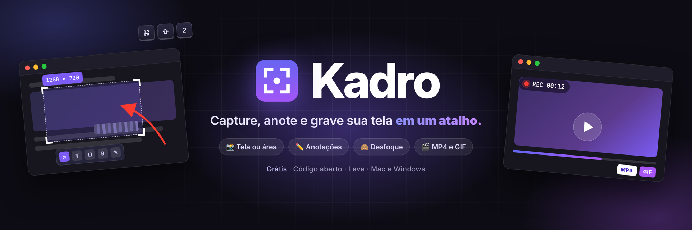

<p align="center"></p>

# Kadro

Captura de tela simples e rápida para macOS, Windows e Linux, inspirada no Lightshot e no CleanShot.

[](https://buymeacoffee.com/ivanmaeda)

Feito com [Tauri 2](https://v2.tauri.app) (Rust + TypeScript), para ser leve: o instalador fica na casa de poucos MB.

## Download

Baixe a versão mais recente na página de [Releases](https://github.com/IvanFreitasMaeda/kadro/releases/latest):

| Sistema | Download |
| --- | --- |
| macOS com Apple Silicon (M1 ou mais novo), macOS 12.3+ | [Kadro-macOS-AppleSilicon.dmg](https://github.com/IvanFreitasMaeda/kadro/releases/latest/download/Kadro-macOS-AppleSilicon.dmg) |
| Windows 10 (versão 2004+) ou 11 | [Kadro-Windows-Setup.exe](https://github.com/IvanFreitasMaeda/kadro/releases/latest/download/Kadro-Windows-Setup.exe) · [.msi](https://github.com/IvanFreitasMaeda/kadro/releases/latest/download/Kadro-Windows.msi) |
| Linux x86_64 (beta) | [AppImage](https://github.com/IvanFreitasMaeda/kadro/releases/latest/download/Kadro-Linux-x86_64.AppImage) · [.deb](https://github.com/IvanFreitasMaeda/kadro/releases/latest/download/Kadro-Linux-x86_64.deb) · [.rpm](https://github.com/IvanFreitasMaeda/kadro/releases/latest/download/Kadro-Linux-x86_64.rpm) · Arch: AUR `kadro-bin` |
| Linux ARM64 (beta) | [AppImage](https://github.com/IvanFreitasMaeda/kadro/releases/latest/download/Kadro-Linux-arm64.AppImage) · [.deb](https://github.com/IvanFreitasMaeda/kadro/releases/latest/download/Kadro-Linux-arm64.deb) · [.rpm](https://github.com/IvanFreitasMaeda/kadro/releases/latest/download/Kadro-Linux-arm64.rpm) |

Macs com processador Intel não são suportados. Depois de baixar, veja [Instalar no macOS](#instalar-no-macos) ou [Instalar no Windows](#instalar-no-windows): no Mac são dois comandos no Terminal, porque o app não tem assinatura da Apple. No Linux, veja [Instalar no Linux](#instalar-no-linux).

## O que faz

- Fica na barra de menus (macOS) ou na bandeja (Windows e Linux).
- **Um clique** no ícone abre a captura. Clique direito mostra o menu.
- Selecione uma área arrastando, ou pegue a tela inteira.
- Ajuste a seleção depois: arraste para mover, use as alças para redimensionar.
- Anote antes de copiar: lápis, marca-texto, desfoque (pixeliza dados sensíveis), linha, seta, retângulo, elipse e texto, com cores, três espessuras e desfazer/refazer.
- Copie para a área de transferência ou salve em PNG numa pasta.
- **Copie o texto** que aparece na captura: o Kadro reconhece o texto (OCR) e você seleciona só o trecho que quer, ou copia tudo. Também tem um atalho que copia direto o texto de uma área. Usa o OCR do próprio sistema (Vision no macOS, Windows.Media.Ocr no Windows, Tesseract no Linux), então funciona offline e não aumenta o app. Lê português e inglês.
- Histórico na lateral: as últimas capturas aparecem em miniatura, e um clique copia de novo. Dá para salvar, abrir ou remover cada uma dali.
- Grave a tela inteira ou uma área em **MP4** ou **GIF**. Uma barrinha mostra o tempo e o botão de parar, e fica de fora do vídeo. A gravação vai para a pasta de capturas e aparece no histórico.
- **Desenhe na tela enquanto grava**: com um atalho (ou o lápis na barrinha) dá para riscar, marcar, fazer setas e retângulos por cima da área gravada, e os desenhos saem no vídeo/GIF. Fora do modo desenho os cliques passam direto para os apps. Opcionalmente os traços somem sozinhos depois de 3 segundos.
- **Histórico da área de transferência**, como o Win+V do Windows: um atalho abre uma janelinha perto do mouse com tudo que você copiou (textos, links, imagens e arquivos), do mais novo para o mais antigo. Busque digitando, fixe os que usa sempre e escolha um para copiar de novo. Fica separado do histórico de capturas, com pasta e limites próprios (padrão: últimos 100 itens por 30 dias). Ignora o que gerenciadores de senha marcam como sigiloso.
- Atalhos, pasta de capturas e tamanho dos históricos configuráveis em Preferências.
- Funciona com vários monitores.
- Se atualiza sozinho: avisa quando sai versão nova e instala com um clique.

## Atalhos

| Ação | macOS | Windows e Linux |
| --- | --- | --- |
| Capturar área | `⌘ ⇧ 2` | `Ctrl Shift 2` |
| Capturar tela inteira | `⌘ ⇧ 1` | `Ctrl Shift 1` |
| Abrir/fechar o histórico | `⌘ ⇧ 0` | `Ctrl Shift 0` |
| Gravar a tela / parar a gravação | `⌘ ⇧ 9` | `Ctrl Shift 9` |
| Copiar o texto de uma área (OCR) | `⌘ ⇧ 8` | `Ctrl Shift 8` |
| Histórico da área de transferência | `⌘ ⇧ V` | `Ctrl Shift V` |

Dá para trocar os atalhos em **Preferências…**, no menu do ícone: clique no atalho e pressione a nova combinação. No Linux com Wayland, veja [Atalhos no Wayland](#atalhos-no-wayland).

Dentro da captura:

| Tecla | Ação |
| --- | --- |
| `Enter`, `Ctrl/⌘ C` ou duplo clique | Copiar e fechar |
| `Ctrl/⌘ S` | Salvar na pasta de capturas |
| `Ctrl/⌘ Shift S` | Salvar como… |
| `F` ou `Ctrl/⌘ A` | Selecionar a tela inteira |
| `Esc` ou clique direito | Cancelar |
| `P` `M` `B` `L` `A` `R` `E` `T` | Lápis, marca-texto, desfoque, linha, seta, retângulo, elipse, texto (de novo para soltar) |
| `Shift` enquanto desenha | Trava o ângulo da linha/seta, faz quadrado ou círculo |
| `Ctrl/⌘ Z` · `Ctrl/⌘ Shift Z` | Desfazer · refazer |

No texto, `Enter` confirma e `Shift Enter` quebra a linha.

Para copiar texto da captura, aperte `O` (ou o botão de texto na barra de ferramentas). As palavras reconhecidas ficam destacadas: clique numa palavra ou arraste para selecionar um trecho, dê duplo clique para pegar a linha inteira e `Ctrl/⌘ A` para pegar tudo. `Enter` ou `Ctrl/⌘ C` copia a seleção (ou todo o texto, se nada estiver selecionado). `Esc` desfaz a seleção e, de novo, volta para a captura. No Windows, o OCR usa os idiomas instalados no sistema (Configurações > Hora e idioma > Idioma).

No histórico da área de transferência, digite para buscar e use `↑` `↓` para escolher. `Enter` (ou um clique) copia o item e volta para o app em que você estava, pronto para colar com `Ctrl/⌘ V`. `Ctrl/⌘ 1`–`9` copia um dos nove primeiros, `Ctrl/⌘ P` fixa ou desafixa e `Ctrl/⌘ Delete` remove. `Esc` fecha.

Na gravação:

| Tecla | Ação |
| --- | --- |
| Arrastar | Escolher a área (ou `F` para a tela inteira) |
| `V` · `G` | Vídeo MP4 · GIF animado |
| `Enter` ou duplo clique | Começar a gravar |
| `⌘ ⇧ 9` / `Ctrl Shift 9`, ou clique no ícone do Kadro | Parar e salvar |
| `⌘ ⇧ D` / `Ctrl Shift D`, ou o lápis na barrinha | Ligar/desligar o modo desenho |

No modo desenho:

| Tecla | Ação |
| --- | --- |
| `P` `M` `A` `R` | Caneta, marca-texto, seta, retângulo |
| `1`–`5` | Cor (vermelho, amarelo, verde, azul, branco) |
| `Shift` enquanto desenha | Trava o ângulo da seta, faz quadrado |
| `F` | Liga/desliga apagar sozinho (os traços somem após 3 s) |
| `Ctrl/⌘ Z` | Desfazer |
| `C` ou `Delete` | Limpar todos os desenhos |
| `Esc` | Sair do modo desenho (os desenhos ficam na tela) |

O atalho do modo desenho só existe durante a gravação, então não atrapalha outros apps no resto do tempo. Os desenhos ficam numa janela transparente por cima da área gravada e somem quando a gravação termina.

O botão de lixeira na barrinha descarta a gravação (clique duas vezes). O MP4 sai em 30 quadros por segundo, na resolução da tela (até 4K). O GIF sai em 15 quadros por segundo e no tamanho "normal" da tela (sem o dobro do Retina), com no máximo 1280 px de largura, para não ficar pesado.

As capturas são salvas em `Imagens/Kadro` por padrão. Dá para trocar a pasta em **Preferências…**.

No histórico:

| Tecla | Ação |
| --- | --- |
| Clique na miniatura ou `Enter` | Copiar (gravações são copiadas como arquivo, para colar num chat ou pasta) |
| `↑` `↓` | Escolher a captura |
| `Ctrl/⌘ S` · `Ctrl/⌘ Shift S` | Salvar na pasta (gravações: mostrar na pasta) · salvar como… |
| `Espaço` | Abrir no visualizador de imagens ou player |
| `Delete` | Remover do histórico |
| `Esc` ou clique fora | Fechar |

O histórico guarda as últimas 30 capturas por padrão (dá para mudar ou desativar em **Preferências…**). Elas ficam na pasta de dados do app, separadas da pasta de capturas: remover do histórico não apaga o que você salvou. As gravações não são duplicadas: o histórico só aponta para o arquivo na pasta de capturas.

## Instalar no macOS

1. Abra o `Kadro-macOS-AppleSilicon.dmg` e arraste o Kadro para **Aplicativos**.
2. O app não tem assinatura da Apple, então o Mac bloqueia na primeira vez. Rode no Terminal:

   ```sh
   xattr -cr /Applications/Kadro.app
   tccutil reset ScreenCapture io.github.ivanfreitasmaeda.kadro
   ```

   O primeiro comando tira a "quarentena" do download, que faz o macOS dizer que o app está danificado. O segundo limpa a permissão de gravação de tela de uma versão anterior, se houver.
3. Abra o Kadro. Ele não abre janela: aparece como um ícone na barra de menus. Se ainda aparecer aviso, vá em **Ajustes do Sistema → Privacidade e Segurança** e clique em **Abrir Mesmo Assim**.
4. Na primeira captura o macOS pede a permissão de **Gravação de Tela**. Depois de liberar, feche o Kadro pelo menu do ícone e abra de novo.

Enquanto o app não tiver assinatura da Apple, cada versão nova é vista pelo macOS como outro app. Se a permissão aparecer marcada mas a captura não funcionar, rode de novo o `tccutil reset` acima, abra o Kadro e libere outra vez.

## Instalar no Windows

Rode o `Kadro-Windows-Setup.exe` (ou o `.msi`, se preferir). O SmartScreen pode avisar que o app é desconhecido: clique em **Mais informações → Executar assim mesmo**. O Kadro aparece como um ícone na bandeja, perto do relógio.

## Instalar no Linux

O Linux ainda está em **beta**: foi testado em máquinas virtuais, e cada distribuição tem seus detalhes. Se algo não funcionar, [abra uma issue](https://github.com/IvanFreitasMaeda/kadro/issues/new) dizendo a distribuição, o ambiente (GNOME, KDE…) e se é X11 ou Wayland (`echo $XDG_SESSION_TYPE`).

| Distribuição | Pacote | Como instalar |
| --- | --- | --- |
| Ubuntu, Debian, Mint, Pop!_OS, elementary | `.deb` | `sudo apt install ./Kadro-Linux-x86_64.deb` |
| Fedora, openSUSE, RHEL | `.rpm` | `sudo dnf install ./Kadro-Linux-x86_64.rpm` (openSUSE: `sudo zypper install`) |
| Arch, Manjaro, EndeavourOS | AUR | `yay -S kadro-bin` (ou `paru -S kadro-bin`) |
| Qualquer outra | AppImage | `chmod +x Kadro-Linux-x86_64.AppImage` e abra. Para o AppImage é preciso ter o FUSE (`libfuse2`). |

Em máquinas ARM (Raspberry Pi 5, VMs em Mac Apple Silicon) use os arquivos `arm64`.

Depois de instalar, o Kadro aparece no menu de aplicativos e fica como um ícone na bandeja. Algumas coisas por distribuição:

- **GNOME** (Ubuntu já vem com isso): o ícone da bandeja precisa da extensão [AppIndicator](https://extensions.gnome.org/extension/615/appindicator-support/). No Ubuntu ela já vem ligada; no Fedora instale com `sudo dnf install gnome-shell-extension-appindicator`. Sem ela o Kadro funciona igual pelos atalhos e pelo menu de aplicativos.
- **Copiar texto (OCR)** usa o Tesseract. O `.deb` e o `.rpm` já instalam junto; no AppImage ou se faltar, instale com `sudo apt install tesseract-ocr tesseract-ocr-por`, `sudo dnf install tesseract tesseract-langpack-por` ou `sudo pacman -S tesseract tesseract-data-por tesseract-data-eng`.
- **Wayland** (padrão no Ubuntu, Fedora e KDE recentes): capturas e gravações passam pelo sistema (o "portal"). Na primeira vez o sistema pergunta se o Kadro pode capturar a tela; na primeira gravação ele pede para escolher a tela e, depois disso, lembra a escolha. É preciso ter o `xdg-desktop-portal` com a versão do seu ambiente (`-gnome`, `-kde`, `-wlr` ou `-hyprland`), o que quase toda distribuição já traz.
- **Desenhar durante a gravação** no X11 precisa de um compositor (GNOME, KDE, Cinnamon, XFCE com composição ligada, picom…). Sem ele o lápis some da barrinha.

### Atalhos no Wayland

No Wayland os apps não podem registrar atalhos globais por conta própria. O Kadro tenta, nesta ordem:

1. **Portal de atalhos** (KDE Plasma, GNOME 48 ou mais novo, Hyprland): o sistema mostra uma janela para confirmar os atalhos na primeira vez. Dá para mudar depois nas configurações de teclado do sistema.
2. **Comandos**: em ambientes sem o portal (GNOME antigo, sway e outros), crie os atalhos nas configurações de teclado do sistema apontando para os comandos abaixo. As **Preferências** do Kadro mostram qual caso é o seu e o comando exato (no AppImage, o caminho do arquivo).

| Ação | Comando |
| --- | --- |
| Capturar área | `kadro --area` |
| Capturar tela inteira | `kadro --full` |
| Abrir/fechar o histórico | `kadro --gallery` |
| Gravar / parar | `kadro --record` |
| Copiar texto de uma área | `kadro --text` |
| Histórico da área de transferência | `kadro --clipboard` |

No GNOME: **Configurações → Teclado → Atalhos de teclado → Ver e personalizar → Atalhos personalizados**. No sway: `bindsym Ctrl+Shift+2 exec kadro --area` no `~/.config/sway/config`. Esses comandos também aparecem no clique direito do ícone do Kadro no menu de aplicativos.

No modo Wayland o Kadro roda pelo XWayland (como a maioria dos apps GTK), para que as janelas de captura fiquem por cima de tudo e no lugar certo. Para testar o modo Wayland nativo, abra com `KADRO_WAYLAND=1 kadro`.

## Atualizar ou desinstalar

A partir da versão 0.2.0 o Kadro procura versões novas sozinho (ao abrir e uma vez por dia) e pergunta se você quer atualizar. Dá para procurar na hora em **Verificar atualizações…**, no menu do ícone. A atualização é baixada do GitHub, conferida pela assinatura e instalada, e o Kadro reinicia. No Mac, depois de atualizar, o macOS pede de novo a permissão de **Gravação de Tela**: libere, feche o Kadro pelo menu do ícone e abra de novo. Quem tem a 0.1.0 precisa instalar a 0.2.0 manualmente uma vez.

No Linux, o AppImage e os pacotes `.deb`/`.rpm` instalados pelo arquivo da release se atualizam do mesmo jeito (o `.deb` e o `.rpm` pedem a senha de administrador). Pelo AUR, a atualização vem pelo `yay`/`paru`, como os outros pacotes.

Para instalar uma versão nova do zero, apague a anterior e os dados dela antes. Isso também apaga o histórico e as preferências. As capturas que você salvou na pasta `Imagens/Kadro` **não** são apagadas.

**macOS** (no Terminal):

```sh
osascript -e 'quit app "Kadro"' 2>/dev/null
rm -rf /Applications/Kadro.app \
  ~/Library/Application\ Support/io.github.ivanfreitasmaeda.kadro \
  ~/Library/Caches/io.github.ivanfreitasmaeda.kadro \
  ~/Library/WebKit/io.github.ivanfreitasmaeda.kadro
tccutil reset ScreenCapture io.github.ivanfreitasmaeda.kadro
```

Depois é só seguir o [Instalar no macOS](#instalar-no-macos) com o `.dmg` novo.

**Linux:** feche o Kadro pelo menu do ícone, desinstale (`sudo apt remove kadro`, `sudo dnf remove kadro`, `sudo pacman -R kadro-bin`, ou apague o AppImage) e apague os dados:

```sh
rm -rf ~/.config/io.github.ivanfreitasmaeda.kadro ~/.local/share/io.github.ivanfreitasmaeda.kadro \
  ~/.cache/io.github.ivanfreitasmaeda.kadro ~/.config/autostart/Kadro.desktop
```

**Windows:** feche o Kadro pelo menu do ícone e desinstale em **Configurações → Aplicativos → Kadro → Desinstalar**. Depois, para apagar os dados, rode no PowerShell:

```powershell
Remove-Item -Recurse -Force "$env:APPDATA\io.github.ivanfreitasmaeda.kadro", "$env:LOCALAPPDATA\io.github.ivanfreitasmaeda.kadro" -ErrorAction SilentlyContinue
```

## Desenvolvimento

Requisitos: [Node.js 22+](https://nodejs.org), [Rust](https://rustup.rs) e os [pré-requisitos do Tauri](https://v2.tauri.app/start/prerequisites/) do seu sistema.

```sh
npm install
npm run tauri dev     # roda em modo desenvolvimento
npm run tauri build   # gera o instalador em src-tauri/target/release/bundle
```

No Linux (Ubuntu/Debian) instale antes:

```sh
sudo apt install libwebkit2gtk-4.1-dev libayatana-appindicator3-dev librsvg2-dev \
  libxdo-dev libssl-dev libpipewire-0.3-dev libclang-dev libxcb-randr0-dev \
  libxcb-shm0-dev libxcb-xfixes0-dev tesseract-ocr tesseract-ocr-por
```

Para publicar uma versão nova: suba o número da versão em `src-tauri/tauri.conf.json`, `src-tauri/Cargo.toml` e `package.json`, faça o merge na `main` e rode **Actions → Release → Run workflow** (ou crie a tag, `git tag v0.2.0 && git push origin v0.2.0`). O workflow `Release` gera os instaladores do Mac, do Windows e do Linux (AppImage, `.deb` e `.rpm`, x86_64 e ARM64), os pacotes de atualização assinados e o `latest.json` que o app consulta, e publica tudo na release.

A assinatura das atualizações usa uma chave privada guardada nos secrets do repositório (`TAURI_SIGNING_PRIVATE_KEY` e `TAURI_SIGNING_PRIVATE_KEY_PASSWORD`); a chave pública correspondente está em `plugins.updater.pubkey`, no `tauri.conf.json`. Sem a chave privada não dá para publicar atualizações que as versões instaladas aceitem, então guarde uma cópia dela. A cada PR o workflow `Build` também gera os instaladores, na aba **Actions**, para teste.

Estrutura:

- `src-tauri/src/capture.rs`: captura dos monitores, janelas de seleção, recorte, copiar e salvar.
- `src-tauri/src/ocr.rs`: reconhecimento de texto com o OCR do sistema (Vision no macOS, Windows.Media.Ocr no Windows, Tesseract no Linux).
- `src-tauri/src/tray.rs`: ícone e menu da bandeja.
- `src-tauri/src/updater.rs`: procura, baixa e instala atualizações (GitHub Releases, `latest.json`).
- `src-tauri/src/shortcuts.rs`: atalhos globais configuráveis.
- `src-tauri/src/history.rs`: histórico de capturas (imagem ou gravação, e miniatura em disco).
- `src-tauri/src/record/`: gravação de tela. `macos.rs` usa ScreenCaptureKit + AVAssetWriter, `windows.rs` usa Windows Graphics Capture + Media Foundation (os dois codificam H.264 com o codificador do próprio sistema), `linux.rs` lê a tela pelo X11 (MIT-SHM) ou pelo portal + PipeWire no Wayland e `mp4.rs` codifica com OpenH264, `gif.rs` monta o GIF.
- `src-tauri/src/fileclip.rs`: copia um arquivo (a gravação) para a área de transferência.
- `src-tauri/src/gallery.rs`: janela lateral do histórico.
- `src-tauri/src/clipboard/`: histórico da área de transferência. `mod.rs` vigia o contador de mudanças do sistema (sem abrir a área de transferência), guarda os itens e aplica os limites; `popup.rs` abre a janelinha; `macos.rs` e `windows.rs` cuidam do que é de cada sistema (itens sigilosos, voltar ao app anterior e colar).
- `src-tauri/src/linux/`: o que é só do Linux: captura pelo portal no Wayland, atalhos pelo portal, área de transferência e janela ativa pelo X11.
- `packaging/aur/`: o `PKGBUILD` do pacote `kadro-bin` no AUR.
- `src-tauri/src/settings.rs`: janela de preferências.
- `src-tauri/src/config.rs`: configurações salvas (atalhos, pasta de capturas e tamanho do histórico).
- `src/overlay.ts`: interface de seleção e anotação.
- `src/annotate.ts`: formas das anotações e como desenhá-las.
- `src/gallery.ts`: interface do histórico.
- `src/clipboard.ts`: interface do histórico da área de transferência.
- `src/record.ts`: barrinha de controle da gravação (e as ferramentas do modo desenho).
- `src/draw.ts`: janela transparente onde se desenha durante a gravação (`src-tauri/src/record/draw.rs` abre e liga/desliga).
- `src/settings.ts`: interface das preferências.

## Apoiar o projeto

O Kadro é gratuito. Se ele te ajuda e você quiser apoiar o desenvolvimento, pode me pagar um café:

[](https://buymeacoffee.com/ivanmaeda)

O link também fica no menu do Kadro (**Apoiar o Kadro ☕**) e no rodapé das Preferências.

## Créditos

A ideia e os testes são do Ivan Freitas Maeda. O desenvolvimento foi feito com a ajuda do [Claude](https://claude.ai), da Anthropic, para agilizar o trabalho.

## Licença

MIT
